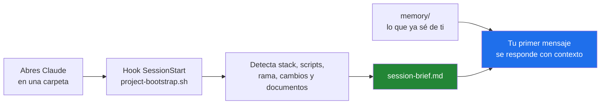
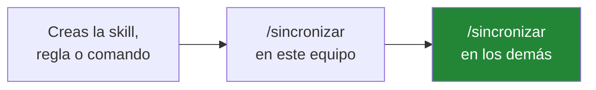

<div align="center">

# ⚙️ claude-config

**Toda mi configuración de Claude Code en un solo sitio, lista para cualquier equipo.**

Clonas, inicias sesión y sigues trabajando. Nada que copiar a mano.


</div>

---

## 🚀 Instalación — 3 pasos

### ① Ejecuta el instalador

<table>
<tr><th align="left">Windows &nbsp;(PowerShell 7)</th></tr>
<tr><td>

```powershell
irm https://raw.githubusercontent.com/tu-usuario/claude-config/main/bootstrap/install.ps1 | iex
```

</td></tr>
<tr><th align="left">macOS · Linux · WSL</th></tr>
<tr><td>

```bash
curl -fsSL https://raw.githubusercontent.com/tu-usuario/claude-config/main/bootstrap/install.sh | bash
```

</td></tr>
</table>

> El instalador **no borra nada** de lo que ya haya en `~/.claude`: respeta credenciales,
> sesiones y cachés locales. Si la carpeta ya es un repositorio, se limita a actualizarla.

### ② Inicia sesión en Claude Code

```bash
claude
```

Las credenciales **nunca** viajan en el repositorio, así que este paso es obligatorio en
cada equipo. Es la única contraseña que tendrás que poner.

### ③ Reinstala plugins y MCP

```bash
# Plugins
claude plugin marketplace add anthropics/claude-plugins-official
claude plugin install figma@claude-plugins-official
claude plugin install rust-analyzer-lsp@claude-plugins-official

# Servidores MCP (autenticación por OAuth al primer uso)
claude mcp add --transport http --scope user figma https://mcp.figma.com/mcp
claude mcp add --transport http --scope user mobai http://127.0.0.1:8686/mcp
```

Detalle completo en [`bootstrap/mcp-servers.md`](bootstrap/mcp-servers.md).

<div align="center">

**✅ Equipo listo.** Abre Claude en cualquier carpeta y todo está cargado.

</div>

---

## 🧠 El primer prompt ya llega con contexto



No tienes que explicarle dónde estás ni qué es el proyecto. Ya lo sabe.

---

## 🔁 Uso diario

| Quiero… | Comando |
|---|---|
| 💾 Guardar mis cambios de configuración y traer los de otro equipo | `/sincronizar` |
| 🧭 Recargar el contexto del proyecto actual | `/arranque` |
| 👀 Ver qué se va a subir | `git -C ~/.claude status --short` |
| 🩺 Comprobar que los MCP responden | `claude mcp list` |

La sincronización **baja primero** (`pull --rebase --autostash`) y luego sube: dos equipos
nunca divergen aunque toques la configuración en ambos el mismo día.

---

## 📦 Qué hay dentro

```
~/.claude/
├── CLAUDE.md            Reglas globales. Se cargan en TODAS las sesiones.
├── rules/               Interacción · principios · agentes · verificación · seguridad
├── skills/        (66)  Diseño, animación, seguridad, móvil, vídeo, evaluación…
├── commands/      (37)  /arranque · /sincronizar · /plan · /auto · /code-review…
├── agents/        (11)  planner · architect · code-reviewer · security-reviewer…
├── hooks/               Automatismos de sesión (incluye project-bootstrap.sh)
├── memory/              Lo que sé de ti. Un hecho por archivo, índice en MEMORY.md
├── bootstrap/           Instaladores · sincronización · hook anti-secretos
├── archive/             Configuración heredada, ya inactiva
└── settings.json        Permisos · hooks · modelo · statusline
```

---

## 🔐 Seguridad — dos barreras

**Barrera 1 · Lista blanca.** El `.gitignore` ignora **todo** por defecto; solo sube lo
que se permite de forma explícita. Un archivo nuevo con secretos no puede colarse por
descuido: simplemente no existe para git.

**Barrera 2 · Hook `pre-commit`.** Aborta el commit si detecta un archivo prohibido o
algo con forma de credencial (`sk-ant-…`, `ghp_…`, `AIza…`, claves privadas, AWS…).

| | Qué |
|---|---|
| ❌ **Nunca se sube** | `.credentials.json` · `*.key` · `*.pem` · `.env` · claves SSH |
| ❌ **Nunca se sube** | `settings.local.json` (permisos propios de cada equipo) |
| ❌ **Nunca se sube** | `projects/` · `sessions/` · `history.jsonl` — tus conversaciones |
| ❌ **Nunca se sube** | Cachés, logs, claves del daemon y copias locales |
| ✅ **Sí se sube** | Skills, reglas, comandos, agentes, hooks, memoria y `settings.json` |

> La memoria (`memory/`) guarda hechos de trabajo, **nunca** contraseñas, tokens ni
> usuarios. Si hace falta citar una credencial, se anota el nombre de la variable de
> entorno, jamás su valor.

---

## 🧯 Si algo falla

| Síntoma | Solución |
|---|---|
| `bad interpreter` al ejecutar un hook | Los `.sh` se han clonado con CRLF: `git -C ~/.claude config core.autocrlf false && git -C ~/.claude checkout -- .` |
| El commit se aborta con `BLOQUEADO` | Es el guardián de secretos. Revisa lo que señala; **no** uses `--no-verify` sin mirarlo. |
| Conflicto al sincronizar | `git -C ~/.claude status` → resuelve → `git -C ~/.claude rebase --continue` |
| No aparece `/arranque` | Reinicia Claude Code; los comandos se leen al arrancar. |
| El briefing no se genera | Ejecuta a mano `bash ~/.claude/hooks/project-bootstrap.sh` y mira el error. |

---

## ➕ Añadir configuración nueva



<div align="center">
<sub>Repositorio privado · sin credenciales · <a href="CLAUDE.md">ver reglas globales</a></sub>
</div>
